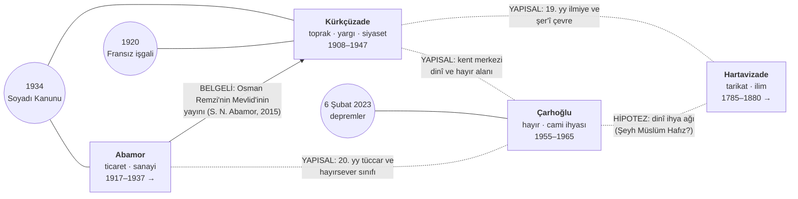

# Şanlıurfa'nın Dört Köklü Ailesi: Kürkçüzade, Çarhoğlu, Abamor ve Hartavizade

**Tarihsel profil, biyografik analiz, çapraz ağ çalışması ve kültürel miras raporu**

Hazırlanma tarihi: 25 Ekim 2026

---

## 0. Yöntem, Kanıt Düzeyleri ve Sınırlar

### 0.1 Kanıt etiketleri

Bu raporda her önemli bilgi aşağıdaki etiketlerden biriyle işaretlenmiştir. Amaç, doğrulanmış tarih ile aile anlatısını ve tevatürü birbirinden kesin çizgilerle ayırmaktır.

| Etiket | Anlamı | Örnek kaynak türü |
|---|---|---|
| **[B]** Belgeli | Birincil belge, resmî kayıt veya birbirinden bağımsız birden çok akademik kaynakla doğrulanmış | Meclis zabıtları, kitabe, hakemli makale, TDV İslâm Ansiklopedisi |
| **[T]** Tek kaynak | Güvenilir ama tek kaynağa dayanan veya kaynaklar arasında çelişkili bilgi | Tek bir akademik çalışma, kurum sayfası |
| **[A]** Aile beyanı | Ailenin kendi yayınları, ticari siteleri veya aile bireyleriyle yapılmış söyleşiler | Firma "hakkımızda" sayfası, gazete röportajı |
| **[Y]** Yerel anlatı | Doğrulanamayan tevatür, lakap açıklaması, rivayet. **"Yerel anlatılara göre"** şerhiyle aktarılır | Halk etimolojisi, sözlü gelenek |
| **[Ç]** Çıkarım | Kaynaklardan yazarın yaptığı analitik çıkarım veya araştırma hipotezi; **olgu değildir** | Bu raporun yorumu |
| **[?]** Boşluk | Erişilebilen kaynaklarda bulunamadı veya doğrulanamadı | — |

### 0.2 Kaynak erişimi ve sınırlar (önemli)

- Bu çalışma, çevrim içi erişilebilen akademik yayınlar (DergiPark, TDV İslâm Ansiklopedisi, TEİS, TÜBA, İSAM), resmî kurum sayfaları (TBMM, Şanlıurfa Büyükşehir Belediyesi, Kültür Portalı, İl Kültür ve Turizm Müdürlüğü), yerel basın ve aile/firma yayınları taranarak hazırlanmıştır.
- **Arşiv çalışması yapılmamıştır.** Osmanlı Arşivi (BOA), Urfa şer'iyye sicilleri, temettuat defterleri, Vakıflar Genel Müdürlüğü vakfiye kayıtları ve nüfus kayıtları doğrudan incelenmemiştir. Kaynaklardaki bazı ifadelere yalnızca arama özetleri üzerinden ulaşılabilmiştir; doğrudan alıntılar yayınlanmadan önce özgün metinlerle karşılaştırılmalıdır.
- Dört aile eşit ölçüde belgelenmiş değildir. **Kürkçüzade** ailesi Osmanlı ve Cumhuriyet resmî kayıtlarında güçlü biçimde görünürken, **Çarhoğlu** ailesi neredeyse yalnızca bir cami kitabesi üzerinden, **Abamor** ailesi büyük ölçüde aile söyleşileri üzerinden, **Hartavizade** ailesi ise bir tasavvuf büyüğü ve onun türbesi üzerinden izlenebilmektedir. Bu dengesizlik raporun bir eksikliği değil, mevcut yazılı kaynakların durumudur ve sonuçlar bu çerçevede okunmalıdır.

---

## 1. Tarihsel Arka Plan: Urfa'da Eşraf Kavramı ve Güç Kaynakları

### 1.1 İdari çerçeve

Osmanlı'nın son döneminde Urfa, **Halep vilayetine bağlı bir sancaktı** [B]. Bu idari bağlılık bazı kaynaklarda görülen bir karışıklığı da açıklar: Mahmut Nedim Bey'in 1908'de "Halep mebusu" olarak anılması, Urfa sancağının Halep vilayeti seçim bölgesi içinde yer almasından kaynaklanıyor olabilir [Ç].

### 1.2 Eşrafın güç kaynakları: genel model

Urfa eşrafının gücü tek bir kaynaktan değil, birbirini besleyen dört sermaye türünün birleşiminden doğar [Ç]:

```
 Toprak / arazi geliri ──► Medrese eğitimi ve şer'î mahkeme görevleri ──► Seçimle gelen siyasi temsil
        │                                                                        │
        └──► Ticaret sermayesi (yağ, yün, tahıl) ──► Sanayi (un, buz) ──► Hayır işleri (cami, vakıf)
                                                                                 │
              Manevi sermaye (tarikat, seyyidlik iddiası) ──► Kanaat önderliği ◄──┘
```

Mekanizmanın işleyişi:

1. **Toprak → siyasi güç:** II. Meşrutiyet seçimleri (1908, 1912, 1914) **iki dereceli** yapılıyordu. Birinci seçmenler, vergi veren erkekler arasından "müntehib-i sânî" (ikinci seçmen) seçiyor, mebusları da bu küçük grup belirliyordu. Mahmut Nedim Bey'in 1908'de **45 oyla** seçilmesi bu dar seçmen tabanını gösterir [T]. Böyle bir sistemde toprak sahibi, vergi veren ve kadılıkla bağı olan eşraf aileleri doğal olarak öne çıkıyordu [Ç].
2. **Eğitim ve yargı → meşruiyet:** Medrese eğitimi ve şer'iyye mahkemesi üyeliği hem bilgi hem de hakemlik sağlıyordu. Bu da seçimlerde güvenilirliğe dönüşüyordu [Ç].
3. **Ticaret → sanayi → hayır işleri:** Cumhuriyet döneminde arazi temelli eşrafın yanında ticaretle zenginleşen aileler yükseldi. Bu aileler sermayelerini önce sanayiye (un ve buz fabrikaları), sonra cami onarımı gibi kamusal hayır işlerine yönelterek toplumsal itibar kazandı [Ç].
4. **Manevi sermaye:** Tarikat silsilesi ve seyyidlik iddiası, siyasi görev olmaksızın da kalıcı bir kanaat önderliği üretir. Bu tür önderlik kuşaklar boyunca aktarılabilir [Ç].

Bu dört aile, söz konusu modelin farklı ayaklarını temsil eder. Bölüm 5'teki sentez bu ayrımı tablolaştırır.

### 1.3 Ortak dönüm noktaları

| Tarih | Olay | Ailelere etkisi |
|---|---|---|
| 1908 | II. Meşrutiyet seçimleri | Kürkçüzade ailesi mebusluk ve belediye reisliğine yükseldi [B] |
| 1919–1920 | İngiliz, ardından Fransız işgali | Kürkçüzade konakları işgal edildi; aile Millî Mücadele anlatısının merkezine girdi [B] |
| 11 Nisan 1920 | Fransızların Urfa'dan çekilmesi | Kentin "Şanlı" unvanının temeli [B] |
| 1934 | Soyadı Kanunu | Kürkçüzade adı Kürkçüoğlu'na dönüştü; Abamor soyadı tescil edildi [T/A] |
| 1934–1937 | Abamor Un Fabrikası'nın inşası ve açılışı | Ticari sermayenin sanayiye dönüşmesi [A] |
| 1950'ler | Demokrat Parti dönemi; cami ihyası dalgası | Çarhoğlu Camii'nin onarımı/yeniden inşası (1955–1957) [B/T] |
| 6 Şubat 2023 | Kahramanmaraş merkezli depremler | Çarhoğlu Camii hasar gördü, Vakıflar tarafından onarıldı [T] |

---

## 2. Aile Profilleri

### 2.1 Kürkçüzade (Kürkçüoğlu) Ailesi

#### Köken ve yerleşim

- **Seyyidlik iddiası:** TDV İslâm Ansiklopedisi, Prof. Kemal Edip Kürkçüoğlu'nun **Abdülkādir-i Geylânî soyundan** geldiğini ve Urfa'nın "Kürkçüoğulları" adıyla tanınmış eski bir ailesine mensup olduğunu kaydeder [T]. *Not: Ansiklopedi bu bilgiyi aile geleneğinden aktarmaktadır. Soy kütüğü (şecere) bağımsız olarak incelenmemiştir.*
- **Yerleşim anlatısı:** Yerel anlatılara göre ailenin atası "Koca" lakaplı bir kişidir. Bu kişi Yavuz Sultan Selim döneminde (1516–1517), Osmanlı'nın bölgeyi almasıyla Urfa'ya yerleşmiş, Kanuni döneminde ise **kale ağası** yapılmıştır [Y/A]. Alternatif bir anlatıya göre ailenin kökü **Malatya Gerger kale ağası Mahmut Koca**'ya dayanır [Y]. İki anlatı birbiriyle çelişmektedir ve ikisi de arşiv belgesiyle doğrulanmamıştır.
- **Lakabın kaynağı:** Yerel anlatılara göre **Halil Koca**'nın kürkçülükle uğraşması aileye "Kürkçü" lakabını kazandırmış, "Kürkçüzâde" (kürkçünün oğlu) adı buradan doğmuştur [Y/A]. Bu açıklama lakabın anlamıyla tutarlıdır, ancak belgelenmemiştir.
- **Soyadı:** Soyadı Kanunu ile (1934) aile **Kürkçüoğlu** adını aldı [T]. TDV maddesine göre Kemal Edip'in kolu, soyadının başkası tarafından alınmış olması nedeniyle bir süre **"Ünsel"** soyadını kullanmış, 1950'den sonra Kürkçüoğlu'na dönmüştür [T]. Bu bilgi, ailenin bütün kollarının 1934'te aynı soyadını alamadığını gösterir.

#### Güç kaynakları

| Alan | Kanıt | Düzey |
|---|---|---|
| **Toprak** | Osman Remzi'nin geçimini "arazi gelirleri ve çiftçilik"ten sağladığı kaydedilir | [T] |
| **Yargı ve ilmiye** | Mahmut Nedim medrese eğitimi almış, şer'iyye mahkemesi ve 1908'de Bidayet Mahkemesi üyesi olmuştur | [T] |
| **Siyaset** | Meşrutiyet döneminde mebusluk; Osmanlı ve Cumhuriyet dönemlerinde en az dört belediye reisi | [B] |
| **Vakıf** | 19. yüzyılda Kürkçüzade Ahmed Bican Efendi'nin Suruç'ta bir cami vakfiyesi (1887) | [T] |
| **Kültür ve ilim** | Şair, edebiyat profesörü ve yerel tarihçi kuşakları | [B] |

**Analiz [Ç]:** Kürkçüzadeler, bölüm 1.2'deki modelin "toprak → yargı → siyaset" zincirinin Urfa'daki en iyi belgelenmiş örneğidir. Ailenin 1908'den 1947'ye kadar kesintili ama sürekli biçimde belediye ve meclis temsili üretmesi, gücünün tek bir bireye değil, bir aile kurumuna dayandığını gösterir.

### 2.2 Çarhoğlu Ailesi

#### Köken ve yerleşim

- **[?]** Erişilebilen yazılı kaynaklarda ailenin Urfa'ya yerleşim tarihi, kökeni veya Osmanlı dönemi kayıtları bulunamamıştır.
- Ailenin kent hafızasındaki varlığı büyük ölçüde **Çarhoğlu Camii** (eski adlarıyla Ömeriye ve Meşarkiye) üzerinden izlenebilmektedir. Caminin avlusundaki kitabeye göre yapı **1955 (h. 1375) yılında Muhammed Çarhoğlu tarafından esaslı biçimde onarılmıştır** [B: kitabe]. Kitabenin hattı Urfalı hattat **Behçet Efendi**'ye aittir [T].
- Caminin bugün **"Çarhoğlu Kardeşler Camii"** olarak da anılması [T], hayrın tek bir kişi değil, kardeşlerden oluşan bir aile ortaklığı tarafından üstlenildiğini düşündürür [Ç].

#### Güç kaynakları

- **[?]** Ailenin ticari faaliyetini doğrudan anlatan bir kaynak bulunamamıştır.
- **[Ç]** 1950'lerde kent merkezinde, Türkmeydanı'na yakın bir caminin esaslı onarımını (bir kaynağa göre yeniden inşasını) üstlenebilmek ciddi bir sermaye birikimi gerektirir. Bu nedenle ailenin 20. yüzyıl ortasında **ticari sermayeye sahip bir hayırsever aile** olduğu güçlü bir çıkarımdır, ancak belgelenmiş bir olgu değildir.
- Şanlıurfa belediye başkanları ve milletvekilleri listelerinde Çarhoğlu soyadına rastlanmamıştır [?]. Bu durum, ailenin gücünü seçimle gelen siyaset yerine **dinî ve hayırsever görünürlük** üzerinden kurduğuna işaret ediyor olabilir [Ç].

### 2.3 Abamor Ailesi

#### Köken ve yerleşim

- Aile yayınlarına göre Abamorlar **1800'lerden beri** Şanlıurfa'da ticaret ve tarımla uğraşmaktadır [A].
- **Lakap ve soyadı:** Aile bireyleri adın kökenini kesin olarak bilmediklerini söyler [A]. Yerel anlatılara göre ad, eskiden zenginlerin giydiği **"mor aba"**dan gelir; bir başka anlatıya göre ise halk arasında kullanılan **"Abamor Ağası"** hitabından türemiştir [Y]. Ali Abamor'un anlatımına göre soyadını dedesi **Halil** almıştır [A].
- **Osmanlı dönemi:** Aile söyleşisine göre aile, Osmanlı döneminde arazilerini **küçük parseller halinde kiracılara** vermiştir [A]. Bu, ailenin ticarete geçmeden önce toprak rantına dayalı bir ekonomik temeli olduğunu gösterir [Ç].

#### Güç kaynakları: ticaretten sanayiye

| Tarih | Gelişme | Düzey |
|---|---|---|
| 1917 | Hacı Osman Abamor sadeyağ ticaretine başladı ve bu işi 47 yıl sürdürdü; "ABAMOR" markası bu tarihe dayandırılır | [A] |
| 1917 sonrası | Yağın yanında yün, yapağı ve sabun ticareti | [A] |
| — | Aile söyleşisine göre Urfa'da üretilen sadeyağın **%55–60'ı** ailenin babası tarafından alınıp Beyrut ve Gaziantep'e satılıyordu | [A] |
| 1934–1937 | **Abamor Un Fabrikası** (Beykapısı) inşa edilip faaliyete geçti. Aile bu fabrikayı "bölgenin ilk tam teşekküllü un fabrikası" olarak tanımlar | [A] |
| 1900'ler başı veya 1937 | **Abamor Buz Fabrikası** (bugünkü "Tarihi Buzhane"). Kaynaklar tarih konusunda çelişkilidir | [A, çelişkili] |
| Bugün | Abamor Yağ Sanayi ve Ticaret Ltd. Şti. (Eyyübiye/ŞUTİM); sadeyağ ve nar ekşisi gibi bölgesel gıda ürünleri | [A] |

**Kuşak bilgisinde çelişki [?]:** Firma sitesi, **Ali Abamor**'un oğullarını Ömer, Hacı Mehmet, Hacı Osman ve Ahmet olarak sayar. 2025 tarihli söyleşide ise (yine Ali adlı) aile büyüğü, soyadını dedesi **Halil**'in aldığını ve **babasının** 1917'de ticarete başladığını söyler. 1917'de başlayan kişi firma sitesine göre Hacı Osman'dır. Bu durumda söyleşideki Ali'nin dedesi Ali olmalıdır, Halil değil. Bu çelişki, aynı adı taşıyan farklı kuşaklardan (Urfa'da yaygın olan "dedenin adını torununa verme" geleneği) veya aktarım hatasından kaynaklanıyor olabilir. **Nüfus kayıtlarıyla çözülmesi gerekir.**

**Analiz [Ç]:** Abamorlar, modelin "toprak rantı → ticaret → sanayi" hattının Urfa'daki açık bir örneğidir. Sadeyağ ticaretinde %55–60 düzeyinde bir pay iddiası doğrulanırsa, aile 1920–1960 arasında kentin kırsal üretimi ile Beyrut–Gaziantep pazarları arasında kilit bir **aracı sermaye** konumundaydı. Un ve buz fabrikaları ise Cumhuriyet'in erken sanayileşme politikalarıyla örtüşen, özel sermayeye dayalı bir yerel modernleşme adımıdır.

### 2.4 Hartavizade (Hartavî) Ailesi

#### Köken ve yerleşim

- Ailenin bilinen en önemli şahsiyeti **Hafız Muhammed Selim Efendi**'dir (d. 1785 Urfa – ö. 1860 Urfa) [B]. Kendisi Nakşibendî-Hâlidî kolunun kurucusu **Mevlânâ Hâlid-i Bağdâdî**'nin müridi ve **Urfa halifesi**dir [B].
- Akademik literatürde adı "Hartavîzâde Şeyh Muhammed Hâfız er-Ruhâvî" ve "Hartavîzâde Şeyh Muhammed Selim Hâfız el-Ruhâvî" biçimlerinde geçer [T, isim farkı]. *"Ruhâvî" nisbesi "Urfalı" anlamına gelir; Urfa'nın Arapça adı "er-Ruhâ"dır.*
- **"Hartavî" adı ve aşiret bağı:** Bugün ağırlıklı olarak **Birecik**'te yaşayan, Kürtçe konuşan ve Hanefî ile Şâfiî mezheplerine mensup bir **Hartavî (Hırtavî) aşireti** bulunmaktadır [T: yerel basın listeleri]. Ancak **şeyh ailesi ile aşiret arasındaki soy bağı belgelenmemiştir** [?]. Yerel bir internet sitesinde yayımlanan "Hartavî aşireti şeceresi" kişileri "es-Seyyid" unvanıyla sayar ve bir "Muhammed Selim Ağa (Hartavî)"nın Ulu Cami'de (Câmi-i Kebîr) gömülü olduğunu kaydeder. Bu şecere doğrulanmamıştır ve şeyh ile aynı kişi olup olmadığı belirsizdir [Y].

#### Güç kaynakları

- **Manevi ve ilmî sermaye:** Urfa salnamesi Muhammed Selim Efendi'yi Türkçe, Farsça ve Arapça şiir yazmış "büyük bir âlim ve şeyh" olarak kaydeder [B: salnameden aktarım]. Hâlidîlik, 19. yüzyılda Anadolu ve Kuzey Mezopotamya'da en hızlı yayılan tasavvufi ağdı. Urfa halifeliği, aileyi bölgesel bir dinî ağın düğüm noktası yapmıştır [Ç].
- **Süreklilik:** Yakın tarihli bir vefat haberi, merhumu "Hartavizade Şeyh Hafız Muhammed Selim Efendi'nin torunu" olarak tanımlar [T]. Bu, şeyh soyunun kent hafızasında bugün de bir kimlik ve prestij kaynağı olarak yaşadığını gösterir.
- **Çağdaş kanaat önderliği:** Hartavî aşiretinin kanaat önderi olarak anılan **Av. Mustafa Hartavî** (ö. yaklaşık 2023), Şanlıurfa Barosu'nun 154 sicil numaralı avukatı, Şanlıurfaspor yönetim kurulu eski üyesi ve bir dönem AK Parti'den Birecik belediye başkanlığı için aday adayıdır. Seçimle bir göreve geldiğine dair kaynak bulunamamıştır [T].

**Analiz [Ç]:** Hartavizadeler, modelin "manevi sermaye → kanaat önderliği" ayağını temsil eder. Bu sermaye türü seçimle gelen göreve dönüşmeden de kuşaklar boyu aktarılabilmiştir. Türbenin bir kentsel dönüşüm sırasında (1874) korunarak taşınması ve ardından türbe yapılması, ailenin 19. yüzyıl sonunda kentsel karar süreçlerini etkileyebilecek bir saygınlığa sahip olduğunu düşündürür.

---

## 3. Önemli Şahsiyetler: Biyografik Analiz

### 3.1 Kürkçüzade (Kürkçüoğlu) Ailesi

| Kişi | Dönem | Görev ve rol | Somut katkı | Düzey |
|---|---|---|---|---|
| **Ahmed Bican Efendi** | 19. yy | Urfa eşrafı | Suruç'ta cami vakfiyesi (1887) | [T] |
| **Mahmut Nedim Bey/Efendi** | Meşrutiyet | Medrese eğitimi; şer'iyye mahkemesi üyesi; 1908'de Urfa Bidayet Mahkemesi üyesi. **Urfa mebusu**: 5 Aralık 1908'de 45 oyla, **bağımsız aday** olarak seçildi. Bir çalışmaya göre 1908, 1912 ve 1913 seçimlerinin üçünde de kazandı. Vikipedi, görev süresini 17 Aralık 1908 – 21 Aralık 1918 olarak verir | Meşrutiyet meclisinde Urfa'nın temsili; İttihatçı aday karşısında bağımsız bir eşraf sesi | [B/T] |
| **Ömer Edip Efendi** | 1908–1915 | **Urfa belediye reisi (1908–1912)**; **Urfa mebusu**: bir kaynağa göre 1912 ve 1914 seçimlerinde Şeyh Safvet ile birlikte seçildi. 1915 Meclis-i Mebusan zabıtlarında "Urfa Mebusu Ömer Edip Efendi" olarak geçer. Kasım 1915'te Çanakkale karargâhına giden meclis heyetinde yer aldığı aktarılır | Meşrutiyet döneminde belediye yönetimi; savaş döneminde meclis temsili | [B: zabıt, belediye listesi] |
| **Osman Remzi** | 1875/1879 – 1924/1926 | **Urfa belediye reisi (1914–1916)**; şair (mahlası büyük ihtimalle "Ruhâvî", bazı kaynaklarda "Rehâvî") | *Sergüzeşt-i Mâzî yahud Vâmık u Azrâ* mesnevisi (realist halk hikâyesine yakın bir deneme); *Mevlid*; Ali Emîrî'ye nazireler. Klasik Türk şiirinin "son temsilcileri"nden sayılır | [B] |
| **Celal Nedim Kürkçüoğlu** | 1930–1933 | Şanlıurfa belediye başkanı | [?] Dönemine ait somut icraat bulunamadı | [B: belediye listesi] |
| **Fazıl Kürkçüoğlu** | 1946–1947 | Şanlıurfa belediye başkanı | [?] | [B: belediye listesi] |
| **Prof. Kemal Edip Kürkçüoğlu** | 20. yy (yaklaşık 1902–1977; tarihler TDV maddesinden teyit edilmeli) | Arap dili ve edebiyatı akademisyeni, şair; Ömer Edip'in oğlu | Akademik Arap filolojisi; Urfa kökenli bir aileden ulusal düzeyde akademisyen. Şiir zevkini babası ve amcası Osman Remzi'ye borçlu olduğunu söyler | [B] |
| **Dr. Ahmet Cihat Kürkçüoğlu** | Günümüz | Urfa kültür tarihi araştırmacısı | Şanlıurfa Dergisi (ŞURKAV) yazıları; örneğin "Urfa'da Miftahîzade Ailesi" (sayı 47, 2024). Kent hafızasının kayda geçirilmesi | [T] |

**Akrabalık çıkarımları:**
- **[Ç, güçlü]** Kemal Edip'in babası Ömer Edip, amcası ise Osman Remzi'dir. Buna göre **Ömer Edip ile Osman Remzi kardeştir**. Böylece iki kardeş, Urfa belediye reisliğini 1908–1916 arasında neredeyse art arda (1912–1914 arası Halil Akyüz dönemi hariç) yürütmüştür.
- **[Ç, hipotez]** Celal **Nedim** Kürkçüoğlu'nun adı, Mahmut **Nedim**'in oğlu veya torunu olabileceğini akla getirir. Bu yalnızca bir ad benzerliğidir; nüfus kaydıyla doğrulanmadan akrabalık olarak sunulmamalıdır.
- **[?]** Mahmut Nedim ile Ömer Edip arasındaki akrabalık derecesi (kardeş, amca oğlu veya başka) kaynaklarda bulunamamıştır.

**Çelişki notu (mebusluk):** Bir kaynak Mahmut Nedim'i 1908–1918 arasında üç seçimde de kazanmış gösterirken, bir başka kaynak 1912 ve 1914 seçimlerinde Urfa'yı Şeyh Safvet ile Ömer Edip'in temsil ettiğini yazar. 1915 zabıtlarında Ömer Edip'in "Urfa mebusu" olarak geçmesi ikinci görüşü destekler. Üç ihtimal vardır: (a) iki Kürkçüzade farklı dönemlerde seçilmiştir, (b) sancağın birden çok sandalyesi vardır, ya da (c) kaynaklardan biri hatalıdır. **TBMM Meclis-i Mebusan albümleri ve seçim mazbatalarıyla çözülmelidir.**

**Modernleşmeye katkı (genel değerlendirme) [Ç]:** Ailenin katkısı üç düzlemde toplanır: (1) Meşrutiyet'in temsilî kurumlarına Urfa'nın erken katılımı; (2) belediye teşkilatının ilk kuşak yöneticiliği (1908–1916); (3) klasik edebiyattan modern akademiye uzanan bir kültürel süreklilik. Belediye dönemlerine ait somut kentsel icraat (yol, su, aydınlatma vb.) bu taramada **bulunamamıştır**. Bu konu belediye meclis kararları ve Halep vilayeti salnameleriyle araştırılmalıdır.

### 3.2 Çarhoğlu Ailesi

| Kişi | Dönem | Rol | Somut katkı | Düzey |
|---|---|---|---|---|
| **Muhammed Çarhoğlu** | 1950'ler–1960'lar | Hayırsever (meslek bilgisi yok) | Ömeriye/Meşarkiye Camii'nin esaslı onarımı (1955 kitabesi). Bir mermer levhaya göre yapı 1965'te (h. 1385) onarılarak camiye dönüştürülmüştür. Bir başka kaynağa göre eski cami 1950'lerde yıkılmış ve yerine "Çarhoğlu Camii" adıyla yenisi yapılmıştır | [B: kitabe; tarihler çelişkili] |
| **"Çarhoğlu Kardeşler"** | 20. yy ortası | Hayır ortaklığı | Caminin bugünkü adı | [T] |

**Tarih çelişkisi:** Avlu kitabesi 1955 (h. 1375), iç onarım kitabesi ebced hesabına göre 1956–1957 (h. 1376), mermer levha ise 1965 (h. 1385) tarihini verir. Ayrıca Şeyh Müslüm Hafız'ın biyografisi, caminin 1956'da onun tasarımıyla ve "Urfalı hayırseverlerin" bağışlarıyla yeniden yapılan camiler arasında olduğunu belirtir [T]. **[Ç]** En tutarlı okuma şudur: 1955–1957 arasında Şeyh Müslüm Hafız'ın yönlendirmesiyle ve Çarhoğlu ailesinin finansmanıyla yeniden inşa veya esaslı onarım yapılmış, 1965'te ise ikinci bir onarım gerçekleştirilmiştir. "Kilise iken camiye çevrildi" ifadesi ise ayrıca incelenmesi gereken, belki daha eski bir yapı tarihine işaret eden bir bilgidir.

**Caminin kökeni:** Kaynaklar yapının ilk inşası konusunda da ayrışır: 16. yüzyıl başı [T], 1728'de (h. 1141) Urfa valisi Hüseyin Paşa tarafından [T] veya "inşa kitabesi olmadığı için bilinmiyor" [T]. Bu ayrışma, Çarhoğlu ailesinin **köklü bir yapıyı ihya eden aile** olarak kent hafızasına girdiğini, yapının kurucusu olmadığını gösterir [Ç].

### 3.3 Abamor Ailesi

| Kişi | Dönem | Rol | Somut katkı | Düzey |
|---|---|---|---|---|
| **Halil Abamor** | 1934 civarı | Söyleşiye göre soyadını alan dede | — | [A] |
| **Ali Abamor (büyük)** | 19. yy sonu – 20. yy başı | Firma sitesine göre Ömer, Hacı Mehmet, Hacı Osman ve Ahmet'in babası | — | [A] |
| **Hacı Osman Abamor** | 1917'den itibaren 47 yıl | Sadeyağ tüccarı | Urfa sadeyağının Beyrut ve Gaziantep pazarlarına bağlanması | [A] |
| **Ömer Abamor ve kardeşleri** | 1934–1937 | Sanayici; büyük oğul | Un fabrikası ve buz fabrikası | [A] |
| **Ali ve Semih Abamor** | Günümüz | Tüccar | Aile hafızasının sözlü tarih olarak kaydı (GAP Gündemi söyleşisi, 9 Eylül 2025; aracı Fuat Rastgeldi) | [A] |
| **Semra Nur Abamor** | 2015 | Akademik yayıncı ve editör | *20. Yüzyıldan Bir Dîvân Edebiyatı Esintisi: Mevlid-i Nebevî – Kürkçüzâde Osman Remzi* (Erkam Yayınları, İstanbul 2015) | [B: atıflarda kullanılan yayın] |

Abamor ailesinden milletvekili veya belediye başkanı çıktığına dair kaynak bulunamamıştır [?]. Ailenin etkisi **siyasi değil ekonomik** niteliktedir.

### 3.4 Hartavizade Ailesi

| Kişi | Dönem | Rol | Somut katkı | Düzey |
|---|---|---|---|---|
| **Hafız Muhammed Selim Efendi** | 1785–1860 | Nakşibendî-Hâlidî şeyhi; Mevlânâ Hâlid'in Urfa halifesi; şair | Hâlidîliğin Urfa'da kurumsallaşması; Türkçe, Farsça ve Arapça şiir | [B] |
| **Ferideddin Efendi** | 1880 | Şeyhin oğlu | Babasının türbesini yaptırdı (1880 / h. 1298) | [B: kitabe aktarımı] |
| **Torunlar** | 20.–21. yy | Şeyh soyu | Aile kimliğinin sürdürülmesi | [T] |
| **Av. Mustafa Hartavî** | ö. yaklaşık 2023 | Avukat; Hartavî aşireti kanaat önderi | Baro, spor kulübü ve sivil toplum üzerinden kentsel temsil | [T] *(Şeyh soyuyla bağı belgelenmemiştir)* |

---

## 4. Açıklamalı İlişkilendirme Çalışması (Çapraz Ağ Analizi)

### 4.1 Temel bulgu

> **Erişilebilen yazılı kaynaklarda bu dört aile arasında belgelenmiş bir evlilik bağı, ticari ortaklık veya siyasi ittifak bulunamamıştır.**

Bu bir "bağ yoktur" hükmü değildir. Urfa eşrafı arasında akraba ve aileler arası evliliğin yaygın olduğu bilinmektedir. Ancak bu tür bağlar genellikle **nüfus kayıtlarında, şer'iyye sicillerindeki nikâh ve miras kayıtlarında ve aile hafızasında** saklıdır, yayımlanmış literatürde ise nadiren yer alır. Bu rapor, olmayan bir bağı icat etmek yerine (a) **belgelenmiş kesişimleri**, (b) **yapısal (aynı ortamı paylaşma) kesişimleri** ve (c) **test edilmesi gereken hipotezleri** ayrı ayrı sunar.

### 4.2 Bağlantı matrisi

Satır ve sütunlar aileleri, hücreler ise bağın türünü ve kanıt düzeyini gösterir.

| | **Kürkçüzade** | **Çarhoğlu** | **Abamor** | **Hartavizade** |
|---|---|---|---|---|
| **Kürkçüzade** | — | **Yapısal:** Aynı kent merkezinde dinî ve hayır alanının farklı dönemlerdeki aktörleri. Doğrudan bağ yok [?] | **Belgeli (kültürel):** Semra Nur Abamor, Kürkçüzade Osman Remzi'nin *Mevlid*'ini yayımladı (2015) [B]. Akrabalık bağı doğrulanmadı [?] | **Yapısal:** 19. yüzyılda Urfa ilmiye ve şer'î çevresinin (medrese, mahkeme, tarikat) paylaşılması [Ç]. "Ruhâvî" nisbesi ve mahlası ortak kimlik göstergesi |
| **Çarhoğlu** | (simetrik) | — | **Yapısal:** 20. yüzyıl ortası Urfa tüccar ve hayırsever sınıfının üyeleri [Ç]. Ortaklık belgesi yok [?] | **Yapısal:** Dinî yapıların ihyası ve tasavvufi çevre (Şeyh Müslüm Hafız üzerinden dolaylı bir ilişki ihtimali) [Ç] |
| **Abamor** | (simetrik) | (simetrik) | — | **Bilinmiyor** [?] |
| **Hartavizade** | (simetrik) | (simetrik) | (simetrik) | — |

### 4.3 Ağ diyagramı

Düz çizgiler belgelenmiş bağları, kesikli çizgiler yapısal veya hipotetik bağları gösterir.



### 4.4 Ailelerin kesiştiği tarihî olaylar

#### a) 1908–1914 Meşrutiyet seçimleri: eşraf ile parti arasındaki rekabet
- **Olgu [T]:** 1908'de Urfa'nın iki ana adayından biri İttihat ve Terakki'ye mensup **Şeyh Safvet**, diğeri **bağımsız aday Kürkçüzade Mahmut Nedim** idi.
- **Analiz [Ç]:** Bu tablo, Urfa'da eski eşraf ağının (Kürkçüzade) ile yeni parti örgütünün (İttihatçılar) aynı küçük seçmen havuzunda rekabet ettiğini gösterir. Şeyh Safvet'in bir tarikat şeyhi olması da dikkat çekicidir: dinî otorite parti tabanına, eşraf ağı ise bağımsız adaylığa kanalize olmuştur. Hartavizade ailesinin bu seçimlerde bir rolü olduğuna dair kaynak **bulunamamıştır** [?].

#### b) 1920 Fransız işgali ve Urfa Mücahedesi
- **Olgu [B]:** Fransızlar Memleket Hastanesi'ni, **Mahmut Nedim Bey'in evini**, **Kürkçüzade Osman Efendi'nin evini**, Şişko'nun evini ve Karalökzadelerin evini ve bağını işgal ederek kışla, karargâh ve depo olarak kullandı.
- **Olgu [T]:** *Millî Mücadele Albümü*'ne dayanan bir görselde **Kürkçüzade Ömer Edip Efendi'nin evi** "Fransızların ilk karargâhlarından" biri olarak gösterilir.
- **Olgu [T, hatırat]:** Fransız komutanı boş süvari kışlasını beğenmemiş, yaklaşık **40 kişilik hanesiyle** birlikte Mahmut Nedim Bey'i evinden çıkararak konağa yerleşmiştir.
- **Olgu [T]:** Kuvâ-yı Millîye ve yerel önderler, son saldırıdan önce Mahmut Nedim Efendi'nin konağına topyekûn ateş açılmasını planladı. 9–10 Şubat 1920 gecesi (bir kaynağa göre 8–9 Şubat) Yüzbaşı **Ali Saip Bey (Ursavaş)** komutasındaki kuvvetler baskın düzenledi. Bir kaynağa göre bu konak çevresinde **19 şehit** verildi. Fransızlar 11 Nisan 1920'de kentten çekildi.
- **Analiz [Ç]:** İşgalcinin karargâh olarak en büyük ve en sağlam taş konakları seçmesi, Kürkçüzade ailesinin kentteki **maddi üstünlüğünün** dolaylı ama güçlü bir kanıtıdır. Aile, işgalin hem mağduru hem de kentin kurtuluş anlatısının mekânsal merkezi olmuştur. Diğer üç ailenin 1920 olaylarındaki rolü bu taramada **bulunamamıştır** [?].
- *Not:* "Kürkçüzade Osman Efendi"nin şair ve belediye reisi Osman Remzi ile aynı kişi olup olmadığı kaynaklarda belirtilmemiştir [?].

#### c) 1934 Soyadı Kanunu: lakaptan soyadına geçiş
- Kürkçüzade → Kürkçüoğlu (bir kol "Ünsel" adını kullanıp 1950'den sonra Kürkçüoğlu'na döndü) [T]; Abamor lakabı soyadı olarak tescil edildi [A]; Hartavizade → Hartavî [Ç: adlandırma süreklilikten çıkarılmıştır].
- **Analiz [Ç]:** Soyadı Kanunu, "-zâde" ekiyle ifade edilen Osmanlı eşraf kimliğini Cumhuriyet'in nüfus düzenine taşımıştır. Bir aile kolunun istediği soyadını alamaması, kanunun eşraf ağlarını kayıt düzeyinde nasıl bölebildiğini gösteren somut bir örnektir. Bu durum, bugün jenealoji araştırmalarında **aynı ailenin farklı soyadlarıyla kayıtlı olabileceği** anlamına gelir.

#### d) 1950'ler: cami ihyası ve tüccar hayırseverliği
- Çarhoğlu Camii'nin 1955–1957 yıllarındaki onarımı ve yeniden inşası [B/T]; aynı yıllarda Abamor ailesinin sadeyağ ticaretindeki yüksek payı [A].
- **Analiz [Ç]:** Çok partili döneme geçişle birlikte dinî yapıların ihyası kamusal alanda yeniden meşrulaştı. Ticari sermaye sahibi aileler (Çarhoğlu örneğinde belgeli olarak) bu alanda görünür hâle geldi. Toplumsal itibar, Osmanlı'daki "mebus ve kadı" kanalından Cumhuriyet'te "**hayırsever tüccar**" kanalına kaymıştır.

### 4.5 Güç dengeleri: zaman içinde sermaye türlerinin el değiştirmesi

| Dönem | Baskın sermaye türü | Öne çıkan aile | Mekanizma |
|---|---|---|---|
| 1785–1880 | Manevi ve ilmî | **Hartavizade** | Hâlidî halifeliği, türbe, salnamede anılma |
| 1880–1920 | Toprak, yargı ve siyaset | **Kürkçüzade** | Medrese ve mahkeme görevleri → iki dereceli seçim → mebusluk ve belediye reisliği |
| 1917–1960 | Ticari ve sanayi | **Abamor** | Sadeyağ aracılığı → un ve buz fabrikaları |
| 1950–1970 | Hayır ve kentsel görünürlük | **Çarhoğlu** | Cami ihyası, kitabe yoluyla kalıcı kent hafızası |
| 1970 sonrası | Kültürel ve sembolik | Kürkçüoğlu (tarih yazımı), Abamor (marka), Hartavî (kanaat önderliği) | Aile tarihinin yazılması ve yayımlanması, markalaşma, sivil toplum |

**[Ç] Ana tez:** Bu dört aile birbirinin rakibi veya müttefiki olmaktan çok, Urfa'nın 19. yüzyıldan bugüne geçirdiği **seçkin dönüşümünün art arda gelen evrelerini** temsil eder. Dinî ve ilmî seçkinlerden toprak ve bürokrasi seçkinlerine, oradan ticari ve sanayi seçkinlerine, en sonunda da kültürel ve sembolik sermayeye uzanan bu çizgi, Osmanlı'dan Cumhuriyet'e taşra eşrafının genel dönüşümüyle de uyumludur.

### 4.6 Test edilmesi gereken hipotezler

| # | Hipotez | Neden akla geliyor | Nasıl test edilir |
|---|---|---|---|
| H1 | Abamor ve Kürkçüzade aileleri arasında akrabalık bağı vardır | Semra Nur Abamor'un 2015'te Osman Remzi'nin Mevlid'ini yayımlaması; Ali Abamor'un söyleşide ailede "şair olarak tanınan" birinden ve dedesinin iki eşinden söz etmesi | Nüfus kayıtları (e-Devlet soy ağacı, aile bireylerinin onayıyla); yayının önsözü; aile söyleşisi |
| H2 | Hartavizade şeyh soyu ile Birecik'teki Hartavî aşireti aynı kökene sahiptir | Ad birliği; seceredeki "Muhammed Selim Ağa (Hartavî)" kaydı | Şecere belgesinin aslı; BOA aşiret kayıtları; Birecik nüfus defterleri |
| H3 | Çarhoğlu Camii'nin ihyası, Hâlidî ve Nakşî çevrelerle (Şeyh Müslüm Hafız) bağlantılı bir hayır ağının parçasıdır | Şeyh Müslüm Hafız'ın 1956'da yeniden yapılan camiler arasında Çarhoğlu Camii'ni sayması | Vakıflar GM cami dosyası; dönemin yerel gazeteleri; kitabe metinleri |
| H4 | Celal Nedim Kürkçüoğlu, Mahmut Nedim'in doğrudan torunudur | Ad benzerliği | Nüfus kaydı |
| H5 | Çarhoğlu ve Abamor aileleri sadeyağ veya tahıl ticaretinde ticari ilişki içindeydi | Aynı dönemde aynı çarşı ekonomisinde yer almaları | Ticaret Odası sicilleri; Ticaret Sicili Gazetesi |

---

## 5. Somut Kültürel ve Ekonomik Miras

### 5.1 Envanter

| Yapı veya kurum | Aile | Konum | Tarih | Durum | Düzey |
|---|---|---|---|---|---|
| **Kürkçüzade Mahmut Nedim Efendi Konağı** | Kürkçüzade | Tarihî kent merkezi | 19. yy sonu – 20. yy başı [Ç] | Kesme taştan yapılmış; kentin önemli konakları arasında sayılır. Bilkent Üniversitesi'nde 2017'de bir belgeleme projesine konu oldu. 1920'de Fransız karargâhı olarak kullanıldı. Güncel tescil ve restorasyon durumu bilinmiyor | [B/T] |
| **Kürkçüzade Halil Hafız Evi** | Kürkçüzade | Tarihî kent merkezi | — | İl Kültür ve Turizm Müdürlüğü yayınlarında "görülmeye değer örnek Şanlıurfa evleri" arasında listelenir | [T] |
| **Kürkçüzade Ömer Edip Efendi'nin evi** | Kürkçüzade | — | — | 1920'de Fransızların ilk karargâhlarından biri; bugünkü durumu bilinmiyor [?] | [T] |
| **Suruç'taki cami vakfı** | Kürkçüzade (Ahmed Bican Efendi) | Suruç | 1887 vakfiyesi | Vakfiye bir akademik yayında incelenmiştir | [T] |
| **Çarhoğlu Camii** (Ömeriye / Meşarkiye; "Çarhoğlu Kardeşler Camii") | Çarhoğlu | Türkmeydanı / Kurtuluş Mah., Meşarkiye Sok. (Eyyübiye; bazı kaynaklarda Haliliye) | Kökeni tartışmalı (16. yy ile 1728 arası); Çarhoğlu onarımları 1955–1957 ve 1965 | 6 Şubat 2023 depremlerinde hasar gördü, Vakıflar Bölge Müdürlüğü'nce onarılıp ibadete açıldı. Eylül 2026 civarında yaşanan bir deprem sonrasında **minaresi yıkıldı (veya güvenlik nedeniyle yıktırıldı)** ve Meşarkiye Caddesi geçici olarak trafiğe kapatıldı | [B/T] |
| **Abamor Un Fabrikası** | Abamor | Beykapısı | 1934–1937 | Güncel durumu bilinmiyor [?] | [A] |
| **Abamor Buz Fabrikası / "Tarihi Buzhane"** | Abamor | Kent merkezi | 1900'ler başı veya 1937 (çelişkili) | Aile, yapının bugün "Tarihi Buzhane" olarak bilindiğini belirtir. Tescil ve restorasyon bilgisi bulunamadı | [A] |
| **Ziyalı Abamor Camii** | Abamor | Tepe Mah., Eyyübiye | Bilinmiyor | Cami listelerinde kayıtlı; yaptıran kişi ve yapım yılı bulunamadı [?] | [T] |
| **Abamor Taziye Evi** | Abamor | Tepe Mah., 2929. Sok., Eyyübiye | Çağdaş | Faal. Ailenin mahalle ölçeğinde bir toplumsal hizmet kurumu | [T] |
| **Abamor markası** (sadeyağ, nar ekşisi) | Abamor | Eyyübiye ve ŞUTİM | 1917'den bugüne | Faal ticari miras | [A] |
| **Hartavizade Hafız Muhammed Selim Türbesi** | Hartavizade | Bamyasuyu Mah., Dabakhane Camii'nin batı kapısının yanı | 1880 (h. 1298) | Şeyh 1860'ta Mevlid-i Halil Kabristanı'na gömülmüş, kabri 1874'te yol çalışması nedeniyle taşınmış, türbe 1880'de oğlu Ferideddin tarafından yaptırılmıştır. Kültür Portalı'nda gezilecek yer olarak kayıtlı; ziyarete açık | [B] |

### 5.2 Kent hafızasındaki yerleri

- **Kürkçüzade:** Kurtuluş Savaşı anlatısının mekânsal merkezi, yani işgal edilen ve kuşatılan konaklar. Aynı zamanda klasik şiirden modern akademiye ve yerel tarih yazıcılığına uzanan bir **"kendi tarihini yazan aile"** [Ç]. Ailenin genç kuşaklarının Urfa tarihi üzerine yayın yapması, ailenin kent hafızasındaki yerini kendi eliyle de kayda geçirmesi anlamına gelir. Bu durum, aile kaynaklı anlatıların akademik eleştiriyle okunması gerektiğini de hatırlatır.
- **Çarhoğlu:** Kent hafızasında neredeyse tamamen **bir cami adıyla** yaşar. Urfa'da hayırseverin adının yapıya geçmesi, kitabe geleneğinin bir aileyi nasıl kalıcı kıldığının iyi bir örneğidir [Ç].
- **Abamor:** "Urfa sadeyağı" kimliğinin ticari taşıyıcısı ve kentin ilk sanayi adımlarının (un ve buz) özel sermaye ayağı. Buzhane, Urfa'nın sıcak iklimindeki gündelik hayatın modernleşmesinin sembolik bir mekânıdır [Ç].
- **Hartavizade:** Urfa'nın tasavvufi coğrafyasında Dabakhane–Bamyasuyu hattındaki türbe ve kent içi ziyaret kültürünün bir parçası [B/Ç].

---

## 6. Sentez Tablosu

| Ölçüt | Kürkçüzade | Çarhoğlu | Abamor | Hartavizade |
|---|---|---|---|---|
| İlk belgeli iz | 19. yy (1887 vakfiyesi); 1908 seçimleri | 1955 kitabesi | 1917 (aile beyanı) | 1785 (şeyhin doğumu) |
| Köken anlatısı | Kale ağalığı, kürkçülük, seyyidlik [Y/T] | [?] | "Mor aba" ve "Abamor Ağası" [Y] | Hâlidî silsilesi [B]; aşiret bağı [?] |
| Ana güç kaynağı | Toprak, yargı, siyaset | Ticaret ve hayır [Ç] | Ticaret ve sanayi | Tarikat ve ilim |
| Mebus veya milletvekili | Evet (Meşrutiyet) [B] | Bulunamadı | Bulunamadı | Bulunamadı |
| Belediye başkanı | Evet, dört kişi (1908–1947) [B] | Bulunamadı | Bulunamadı | Bulunamadı |
| Din âlimi veya şeyh | Medrese ve kadılık çevresi [T] | — | — | Evet [B] |
| Somut miras | Konaklar, vakıf, edebî eserler | Çarhoğlu Camii | Fabrikalar, marka, cami, taziye evi | Türbe |
| Belgelenme düzeyi | Yüksek | Düşük | Orta (aile beyanı ağırlıklı) | Orta |

---

## 7. Araştırma Boşlukları ve Önerilen Kaynaklar

### 7.1 Arşiv kaynakları (öncelik sırasıyla)

1. **Cumhurbaşkanlığı Devlet Arşivleri, Osmanlı Arşivi (BOA):** Urfa sancağı temettuat defterleri (1844–45), DH.SAİD sicil-i ahvâl kayıtları (Mahmut Nedim ve Ömer Edip için), seçim mazbataları.
2. **Urfa şer'iyye sicilleri:** Nikâh, miras ve tereke kayıtları. **Evlilik ağını ortaya çıkarmanın tek güvenilir yolu budur.**
3. **Halep vilayeti salnameleri ve Urfa salnamesi:** Belediye meclisi üyeleri, idare meclisi azaları, ulema listeleri.
4. **Vakıflar Genel Müdürlüğü:** Suruç cami vakfiyesi (1887), Çarhoğlu Camii dosyası, Hartavizade türbesi kayıtları.
5. **TBMM Kütüphanesi:** Meclis-i Mebusan albümleri ve zabıtları (1908–1918), mebusluk çelişkisinin çözümü için.
6. **Nüfus kayıtları:** Aile bireylerinin onayıyla alınacak soy ağacı dökümleri; Soyadı Kanunu dönemindeki soyadı farklılıkları ("Ünsel" örneği).
7. **Ticaret Sicili Gazetesi ve Şanlıurfa Ticaret ve Sanayi Odası:** Abamor ve Çarhoğlu firmalarının ortaklık yapıları.

### 7.2 Literatür

- Abdullah Ekinci, *Urfa Siyaset Bilgeliği* ve Urfa Okulu Araştırma Merkezi yayınları
- Mustafa Can, "Urfa'nın İşgali ve Kurtuluşu" (TÜBA)
- *Ahfada Yadigâr Urfa Mücahedesi* (ŞURKAV yayını)
- Semra Nur Abamor (2015), Osman Remzi'nin *Mevlid*'i (Erkam Yayınları), özellikle önsöz ve biyografi bölümü
- N. Tanç (2017) ile Saraç (2013), Osman Remzi üzerine yüksek lisans tezleri
- *Şanlıurfa* dergisi (ŞURKAV) ve İl Kültür ve Turizm Müdürlüğü dergisi arşivi
- Müslüm Akalın'ın Urfa'nın eski aileleri üzerine çalışmaları

### 7.3 Sözlü tarih önerisi

Dört ailenin yaşlı kuşaklarıyla **yapılandırılmış sözlü tarih görüşmeleri** yapılmalıdır. Görüşme protokolü şunları kapsamalıdır: (a) bilinen en eski ata ve yerleşim yeri, (b) kız alıp verilen aileler, (c) ortak iş yapılan aileler, (d) aileye ait yapılar ve vakıflar, (e) aile içinde saklanan belgeler (tapu, vakfiye, şecere, fotoğraf). Elde edilen her bilgi bu rapordaki kanıt etiketleriyle sınıflandırılmalı ve arşiv kayıtlarıyla çapraz kontrol edilmelidir.

---

## 8. Kaynaklar

### Akademik ve ansiklopedik
- TDV İslâm Ansiklopedisi, "Kürkçüoğlu, Kemal Edip": https://islamansiklopedisi.org.tr/kurkcuoglu-kemal-edip
- Türk Edebiyatı İsimler Sözlüğü (TEİS), "Kürkçü-zâde Osman Remzi": https://teis.yesevi.edu.tr/madde-detay/kurkcuzade-osman-remzi
- TEİS, "Kürkçüoğlu, Kemal Edip": https://teis.yesevi.edu.tr/madde-detay/kurkcuoglu-kemal-edip
- Tanç, N., "Klâsik Türk Şiirinin Son Temsilcilerinden Kürkçü-zâde Osman Remzi ve Ali Emîrî'ye Nazireleri", *Söylem Filoloji Dergisi*: https://dergipark.org.tr/tr/pub/soylemdergi/article/356803
- Tanç, N., "Realist Halk Hikâyesi ile Roman Arasında Kürkçü-zâde Osman Remzi'nin Sergüzeşt-i Mâzî yahud Vâmık u Azrâ Mesnevîsi", *Elektronik Sosyal Bilimler Dergisi*: https://dergipark.org.tr/en/pub/esosder/article/333934
- Ekinci, A., "Urfa Siyaset Bilgeliği": https://dergipark.org.tr/en/download/article-file/1871848
- "Meşrutiyet Yıllarında Urfa'da Cemiyetler ve Kulüpler": https://www.researchgate.net/publication/339018262_Mesrutiyet_Yillarinda_Urfa'da_Cemiyetler_ve_Kulupler
- Can, M., "Urfa'nın İşgali ve Kurtuluşu" (TÜBA): https://www.tuba.gov.tr/files/yayinlar/tarih-serisi/TUBA-978-625-8352-66-5_ch03.pdf
- *Ahfada Yadigâr Urfa Mücahedesi* (ŞURKAV): https://www.sanliurfa.bel.tr/files/1/bsb_sonra/surkav_yayinlari/32_AHFADA_YADIGAR_URFA_MUCAHEDESI.pdf
- "Eşrâf: Cumhuriyet'in Kuruluş Anlatısında Bir Toplumsal Tabaka": https://dergipark.org.tr/tr/download/article-file/2968602
- "Anadolu'da Hâlidiyye Tarikatı ve Ahmed Ziyaüddin Gümüşhânevî" (İSAM): https://isamveri.org/pdfdrg/D229321/2014/2014_MEMISA.pdf
- İslâm Tarihçileri Derneği Şanlıurfa Şubesi ve Şanlıurfa İl Müftülüğü yayını (2016): https://isamveri.org/pdfdrg/D256876/2016/2016_TASY.pdf
- Bilkent Üniversitesi, "Kürkçüzade Mahmut Nedim Efendi Konağı" (2017): https://repository.bilkent.edu.tr/items/bea38f16-9b59-4010-98f1-5ad62a76ed6b/full

### Resmî ve kurumsal
- Meclis-i Mebusan Zabıt Ceridesi, Devre 3: https://www5.tbmm.gov.tr/tutanaklar/TUTANAK/MECMEB/mmbd03ic01c001/mmbd03ic01c001ink044.pdf
- Vikipedi, "Mahmut Nedim Bey": https://tr.wikipedia.org/wiki/Mahmut_Nedim_Bey
- Vikipedi, "TBMM 1. Dönem Urfa milletvekilleri listesi": https://tr.wikipedia.org/wiki/TBMM_1._D%C3%B6nem_Urfa_milletvekilleri_listesi
- Şanlıurfa Büyükşehir Belediyesi, "Eski Başkanlarımız": https://www.sanliurfa.bel.tr/personel-list/20/eski-baskanlarimiz
- Vikipedi, "Şanlıurfa Büyükşehir Belediyesi": https://tr.wikipedia.org/wiki/%C5%9Eanl%C4%B1urfa_B%C3%BCy%C3%BCk%C5%9Fehir_Belediyesi
- Kültür Portalı, "Çarhoğlu Camii": https://www.kulturportali.gov.tr/turkiye/sanliurfa/gezilecekyer/carhoglu-camii
- Kültür Portalı, "Hartavizade Hafız Muhammed Selim Türbesi": https://kulturportali.gov.tr/turkiye/sanliurfa/gezilecekyer/hartav%C3%AEzade-hafiz-muhammed-selim-turbesi
- Yatırım Destek Ofisi Şanlıurfa, "Köşkler ve Konaklar": https://www.investsanliurfa.com/sanliurfa/koskler-ve-konaklar--440
- *Şanlıurfa* dergisi, sayı 47 (ŞURKAV): https://www.surkav.org.tr/icerik/706/sanliurfa-dergisi-47
- İstiklal Marşı Derneği, "Urfa İstiklâl Mücahedesi": https://www.istiklalmarsidernegi.org.tr/IcerikDetay?Id=3&IcerikId=1753

### Yerel basın, söyleşiler ve aile yayınları
- Sarmış, M., "Abamor Ailesi ve Urfa'da Sadeyağ Ticaret Hayatı" (1. bölüm), GAP Gündemi: https://www.gapgundemi.com/makale/26779482/mehmet-sarmis/abamor-ailesi-ve-urfada-sadeyag-ticaret-hayati-1
- Sarmış, M., aynı yazı (2. bölüm): https://www.gapgundemi.com/makale/26787400/mehmet-sarmis/abamor-ailesi-ve-urfada-sadeyag-ticaret-hayati-2
- Sarmış, M., "Urfa'nın Kültür ve Sanatına Adanmış Bir Ömür: Ahmet Cihat Kürkçüoğlu": https://www.gapgundemi.com/makale/23878602/mehmet-sarmis/urfanin-kultur-ve-sanatina-adanmis-bir-omur-ahmet-cihat-kurkcuoglu-1
- Abamor, "Hakkımızda": https://abamor.com.tr/pages/hakkimizda
- Abamor Natural, "Bizim Hikayemiz": https://abamornatural.com/pages/hakkimizda
- "Ziyalı Abamor Camii": https://cami.ahmetcadirci.com/sanliurfa/34WS6U3.html
- Urfagaste, "Şanlıurfa'da Abamor Ailesinin Acı Günü": https://urfagaste.com/haber/27966830/sanliurfada-abamor-ailesinin-aci-gunu
- Urfa Değişim, "Çarhoğlu Kardeşler Camii ibadete açıldı": https://www.urfadegisim.com.tr/osmanli-doneminin-izlerini-tasiyan-carhoglu-kardesler-camii-ibadete-acildi/137159
- RHA Ajans, "Çarhoğlu Camii minaresi yıkıldı": https://rhaajans.com/haber/28867953/sanliurfada-deprem-sonrasi-carhoglu-camii-minaresi-yikildi-mesarkiye-caddesi-trafige-kapatildi
- Gazete İpekyol, "Şanlıurfa'nın tarihi camilerinde deprem sonrası son durum": https://www.gazeteipekyol.com/haber/15706494/sanliurfanin-tarihi-camilerinde-deprem-sonrasi
- Şanlıurfa 63, "Şanlıurfa Camileri": https://www.sanliurfa63.com/sanliurfa-camileri/21691/
- Evliyalar.net, "Şeyh Müslüm Hafız": https://www.evliyalar.net/seyh-muslum-hafiz/
- Şanlıurfa 63, "Hartavi Aşireti Seceresi": https://www.sanliurfa63.com/sanliurfa-hartavi-asireti-hartavi-asireti-seceresi
- Urfastar, "Urfa'da Hartavi ailesi yasta": https://www.urfastar.com/urfada-hartavi-ailesi-yasta
- Urfadasın, "Avukat Mustafa Hartavi Hayatını Kaybetti": https://www.urfadasin.com/avukat-mustafa-hartavi-hayatini-kaybetti
- Urfanatik, "İşte Urfa'daki 173 aşiret": https://www.urfanatik.com/iste-urfadaki-173-asiret
- Urfa Hizmet, "Osmanlıdan Günümüze Kadar Urfa Belediye Başkanları": https://urfahizmet.com/osmanlidan-gunumuze-kadar-urfa-belediye-baskanlari.html
