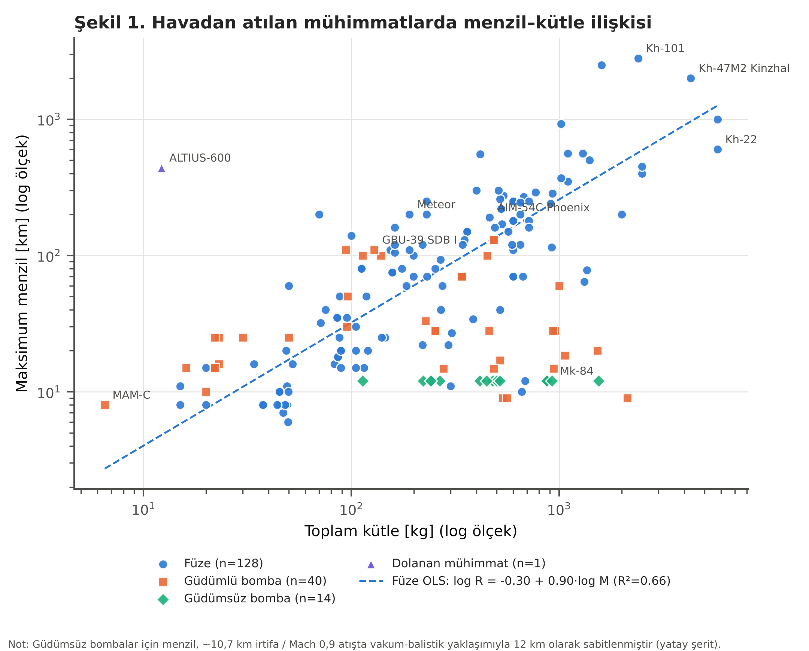
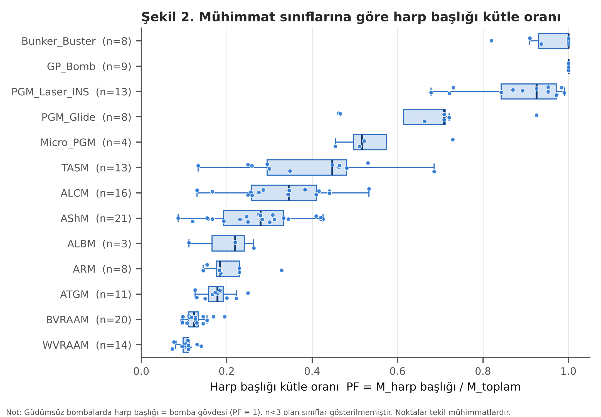
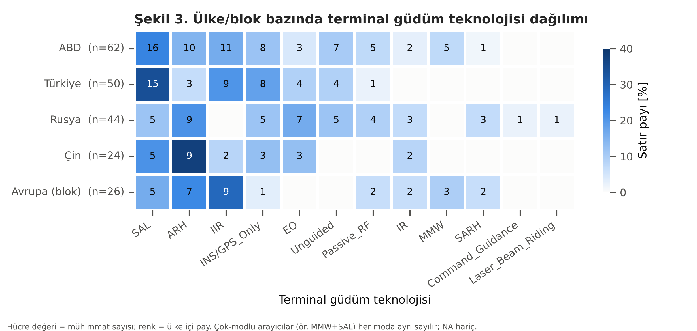

# Havadan Atılan Mühimmatlar Veri Seti — Özet Rapor (EDA)

*Oluşturulma tarihi: 2026-11-09 · Kaynak: `data/processed/master_air_munitions_dataset.csv` · Üretici betik: `src/academic_analysis.py`*

## 1. Veri setinin genel görünümü

- **Toplam kayıt:** 236 mühimmat × 20 öznitelik (+ türetilmiş `Payload_Fraction`)
- **Ülke/köken sayısı:** 18 ISO kodu · **Alt kategori sayısı:** 16
- **Güvenilirlik:** 14 kayıt `Acik_Kaynak_Dogrulanmis`, 222 kayıt `Tahmini_Acik_Kaynak`
- **Türk envanteri / geliştirmesi (TUR):** 50 kayıt

### Tablo 1. Alan doluluk oranları (NA olmayan)

| Sütun | Dolu (n) | Doluluk (%) |
|:---|---:|---:|
| Hizmete_Giris_Yili | 137 | 58.1 |
| Toplam_Kutle_kg | 191 | 80.9 |
| Harp_Basligi_Kutlesi_kg | 166 | 70.3 |
| Uzunluk_m | 168 | 71.2 |
| Cap_mm | 174 | 73.7 |
| Kanat_Acikligi_m | 100 | 42.4 |
| Maksimum_Menzil_km | 214 | 90.7 |
| Maksimum_Hiz_Mach | 150 | 63.6 |
| Birim_Maliyet_USD | 13 | 5.5 |
| Payload_Fraction | 149 | 63.1 |

## 2. Kategorilere göre dağılım

### Tablo 2. Ana kategori × alt kategori sayıları ve menzil istatistikleri

| Ana_Kategori | Alt_Kategori | n_toplam | n_veri | Ort. menzil [km] | Medyan [km] | Std [km] | Min [km] | Maks [km] |
|:---|:---|---:|---:|---:|---:|---:|---:|---:|
| Dolanan_Muhimmat | Loitering | 3 | 1 | 440.0 | 440.0 | — | 440.0 | 440.0 |
| Fuze | ALBM | 6 | 4 | 705.0 | 335.0 | 871.2 | 150.0 | 2000.0 |
| Fuze | ALCM | 23 | 23 | 585.3 | 275.0 | 761.2 | 50.0 | 2800.0 |
| Fuze | ARM | 11 | 10 | 162.8 | 150.0 | 77.3 | 60.0 | 300.0 |
| Fuze | AShM | 25 | 25 | 268.0 | 220.0 | 228.4 | 20.0 | 1000.0 |
| Fuze | ATGM | 18 | 18 | 14.1 | 9.0 | 13.1 | 6.0 | 60.0 |
| Fuze | BVRAAM | 32 | 29 | 126.7 | 110.0 | 76.9 | 40.0 | 400.0 |
| Fuze | Guided_Rocket | 4 | 4 | 56.0 | 33.0 | 66.2 | 8.0 | 150.0 |
| Fuze | HGV | 1 | 1 | 1600.0 | 1600.0 | — | 1600.0 | 1600.0 |
| Fuze | TASM | 14 | 14 | 51.1 | 33.5 | 45.0 | 10.0 | 140.0 |
| Fuze | WVRAAM | 18 | 18 | 26.7 | 20.0 | 16.7 | 8.0 | 80.0 |
| Gudumlu_Bomba | Bunker_Buster | 4 | 3 | 18.5 | 18.5 | 9.5 | 9.0 | 28.0 |
| Gudumlu_Bomba | Micro_PGM | 18 | 13 | 21.1 | 16.0 | 11.0 | 8.0 | 50.0 |
| Gudumlu_Bomba | PGM_Glide | 20 | 18 | 87.2 | 90.0 | 27.6 | 30.0 | 130.0 |
| Gudumlu_Bomba | PGM_Laser_INS | 23 | 17 | 21.2 | 20.0 | 7.9 | 9.0 | 33.0 |
| Gudumsuz_Bomba | Bunker_Buster | 6 | 6 | 12.0 | 12.0 | 0.0 | 12.0 | 12.0 |
| Gudumsuz_Bomba | GP_Bomb | 10 | 10 | 12.0 | 12.0 | 0.0 | 12.0 | 12.0 |

### Tablo 3. Ana kategori özet istatistikleri

| Ana_Kategori | n | Ort. kütle [kg] | Medyan kütle [kg] | Ort. menzil [km] | Medyan menzil [km] | Ort. PF | Medyan PF |
|:---|---:|---:|---:|---:|---:|---:|---:|
| Dolanan_Muhimmat | 3 | 12.20 | 12.20 | 440.00 | 440.00 | — | — |
| Fuze | 152 | 539.03 | 253.00 | 216.14 | 102.50 | 0.23 | 0.18 |
| Gudumlu_Bomba | 65 | 656.82 | 253.00 | 44.31 | 28.00 | 0.78 | 0.78 |
| Gudumsuz_Bomba | 16 | 547.50 | 462.00 | 12.00 | 12.00 | 1.00 | 1.00 |

## 3. Ülkelere göre dağılım

### Tablo 4. Köken ülkeye göre mühimmat sayısı ve ortalama menzil

| Mensei_Ulke | n | Füze | Güdümlü bomba | Güdümsüz bomba | Dolanan | Ort. menzil [km] | Medyan menzil [km] | Ort. PF |
|:---|---:|---:|---:|---:|---:|---:|---:|---:|
| USA | 62 | 35 | 18 | 7 | 2 | 131.14 | 28.00 | 0.51 |
| TUR | 50 | 19 | 26 | 4 | 1 | 74.43 | 28.00 | 0.59 |
| RUS | 44 | 32 | 7 | 5 | 0 | 292.26 | 80.00 | 0.37 |
| CHN | 24 | 20 | 4 | 0 | 0 | 221.95 | 122.50 | 0.19 |
| ISR | 15 | 12 | 3 | 0 | 0 | 121.50 | 89.00 | 0.33 |
| FRA | 9 | 6 | 3 | 0 | 0 | 61.88 | 70.00 | 0.35 |
| GBR | 7 | 6 | 1 | 0 | 0 | 60.14 | 50.00 | 0.14 |
| EUR | 5 | 5 | 0 | 0 | 0 | 261.00 | 200.00 | 0.27 |
| JPN | 4 | 4 | 0 | 0 | 0 | 181.25 | 145.00 | 0.28 |
| ARE | 3 | 0 | 3 | 0 | 0 | 16.00 | 16.00 | 0.52 |
| IND | 3 | 3 | 0 | 0 | 0 | 240.00 | 160.00 | 0.11 |
| SWE | 2 | 2 | 0 | 0 | 0 | 135.00 | 135.00 | 0.32 |
| ZAF | 2 | 2 | 0 | 0 | 0 | 15.00 | 15.00 | — |
| NOR | 2 | 2 | 0 | 0 | 0 | 294.50 | 294.50 | 0.31 |
| BRA | 1 | 1 | 0 | 0 | 0 | 60.00 | 60.00 | 0.33 |
| ITA | 1 | 1 | 0 | 0 | 0 | 100.00 | 100.00 | — |
| PAK | 1 | 1 | 0 | 0 | 0 | 350.00 | 350.00 | 0.41 |
| TWN | 1 | 1 | 0 | 0 | 0 | 60.00 | 60.00 | — |

### Tablo 5. Odak bloklar (Avrupa = EUR + ulusal Avrupa kodları)

| Blok | n | Ort. menzil [km] | Medyan menzil [km] | Maks menzil [km] | Medyan PF | Doğrulanmış (%) |
|:---|---:|---:|---:|---:|---:|---:|
| USA | 62 | 131.1 | 28.0 | 1600.0 | 0.4 | 9.7 |
| TUR | 50 | 74.4 | 28.0 | 275.0 | 0.5 | 8.0 |
| RUS | 44 | 292.3 | 80.0 | 2800.0 | 0.2 | 6.8 |
| CHN | 24 | 221.9 | 122.5 | 2000.0 | 0.2 | 0.0 |
| EUR | 26 | 127.2 | 70.0 | 560.0 | 0.2 | 3.8 |

## 4. Harp başlığı kütle oranı (Payload Fraction)

$PF = M_{harp\,başlığı} / M_{toplam}$ — yalnızca her iki kütlesi bilinen kayıtlar.

### Tablo 6. Alt kategoriye göre PF istatistikleri

| Alt_Kategori | n_toplam | n_veri | Ortalama | Medyan | Std | Min | Maks |
|:---|---:|---:|---:|---:|---:|---:|---:|
| GP_Bomb | 10 | 9 | 1.000 | 1.000 | 0.000 | 1.000 | 1.000 |
| Bunker_Buster | 10 | 8 | 0.958 | 1.000 | 0.066 | 0.820 | 1.000 |
| PGM_Laser_INS | 23 | 13 | 0.884 | 0.925 | 0.109 | 0.679 | 0.990 |
| PGM_Glide | 20 | 8 | 0.670 | 0.709 | 0.150 | 0.462 | 0.925 |
| Micro_PGM | 18 | 4 | 0.554 | 0.516 | 0.120 | 0.455 | 0.729 |
| TASM | 14 | 13 | 0.395 | 0.447 | 0.147 | 0.133 | 0.686 |
| ALCM | 23 | 16 | 0.332 | 0.345 | 0.108 | 0.130 | 0.533 |
| AShM | 25 | 21 | 0.272 | 0.279 | 0.101 | 0.087 | 0.426 |
| Guided_Rocket | 4 | 1 | 0.273 | 0.273 | — | 0.273 | 0.273 |
| ALBM | 6 | 3 | 0.198 | 0.220 | 0.078 | 0.112 | 0.263 |
| ARM | 11 | 8 | 0.205 | 0.184 | 0.059 | 0.145 | 0.328 |
| ATGM | 18 | 11 | 0.178 | 0.178 | 0.037 | 0.126 | 0.250 |
| BVRAAM | 32 | 20 | 0.125 | 0.123 | 0.026 | 0.095 | 0.195 |
| WVRAAM | 18 | 14 | 0.105 | 0.108 | 0.019 | 0.072 | 0.140 |
| HGV | 1 | 0 | — | — | — | — | — |
| Loitering | 3 | 0 | — | — | — | — | — |

## 5. Menzil–kütle ölçeklemesi

### Tablo 7. log₁₀(Menzil) = a + b·log₁₀(Kütle) OLS uyumu

| Kategori | n | egim_b | kesisim_a | R2 |
|:---|---:|---:|---:|---:|
| Fuze | 128.000 | 0.903 | -0.299 | 0.664 |
| Gudumlu_Bomba | 40.000 | 0.100 | 1.239 | 0.034 |
| BVRAAM | 24.000 | 0.595 | 0.631 | 0.266 |
| WVRAAM | 18.000 | 1.031 | -0.660 | 0.202 |
| ALCM | 18.000 | 0.556 | 0.997 | 0.327 |
| AShM | 22.000 | 0.861 | -0.222 | 0.614 |
| ATGM | 18.000 | 0.834 | -0.320 | 0.127 |

Füze sınıfında esneklik katsayısı b ≈ 0.90 (R² = 0.66): kütledeki %10'luk artış, ortalamada menzilde yaklaşık %9.0'lik artışla ilişkilidir. Düşük R², itki tipinin (roket / turbojet / ramjet) kütleden bağımsız güçlü bir menzil belirleyicisi olduğuna işaret eder.

## 6. Terminal güdüm teknolojisi matrisi (Şekil 3 veri tablosu)

| Blok | SAL | ARH | IIR | INS/GPS_Only | EO | Unguided | Passive_RF | IR | MMW | SARH | Command_Guidance | Laser_Beam_Riding |
|:---|---:|---:|---:|---:|---:|---:|---:|---:|---:|---:|---:|---:|
| USA | 16 | 10 | 11 | 8 | 3 | 7 | 5 | 2 | 5 | 1 | 0 | 0 |
| TUR | 15 | 3 | 9 | 8 | 4 | 4 | 1 | 0 | 0 | 0 | 0 | 0 |
| RUS | 5 | 9 | 0 | 5 | 7 | 5 | 4 | 3 | 0 | 3 | 1 | 1 |
| CHN | 5 | 9 | 2 | 3 | 3 | 0 | 0 | 2 | 0 | 0 | 0 | 0 |
| EUR | 5 | 7 | 9 | 1 | 0 | 0 | 2 | 2 | 3 | 2 | 0 | 0 |

## 7. Şekiller

## 8. Yöntem notları ve sınırlılıklar

1. **Kaynaklar:** Üretici katalogları ve resmi açıklamalar (ROKETSAN, TÜBİTAK SAGE, ASELSAN, Baykar, MBDA, Raytheon/RTX, Lockheed Martin, Boeing), ABD savunma bütçe belgeleri, SIPRI, CSIS Missile Threat, Jane's ve savunma basını. Satır bazında kaynak belirsizliği `Veri_Guvenilirlik_Notu` ile işaretlenmiştir.
2. **Gizli/teyit edilemeyen değerler uydurulmamış, `NA` yazılmıştır.** Bu nedenle özellikle geliştirme aşamasındaki sistemlerde (AIM-260, Gökhan, Akbaba, KD-21, ARRW) kayıtlar seyrektir.
3. **Menzil konvansiyonu:** Aralık verilen durumlarda üst sınır alınmıştır (ör. '65+ km' → 65). Güdümsüz bombalar için sabit 12 km değeri, ~10,7 km irtifa ve Mach 0,9 atışta vakum-balistik yaklaşımdır; bir ölçüm değil, sınıf konvansiyonudur.
4. **Hız konvansiyonu:** Serbest düşüş GP bombaları Mach 0,9, sığınak deliciler Mach 1,1 (görev tanımı gereği).
5. **Harp başlığı tanımı:** Bombalarda harp başlığı kütlesi = bomba gövdesi (kasa + dolgu); bu nedenle güdümsüz bombalarda PF ≡ 1 ve güdüm kitlerinde PF ≈ 0,85–0,99'dur. Füzelerde PF patlayıcı değil, harp başlığı bölümünün tamamıdır.
6. **Kütle tanımı:** Havadan atış kütlesi esas alınmıştır; yerden/gemiden atılan sürümlerin booster kütlesi dahil edilmemiştir (BrahMos-A, Atmaca, Kh-35U).
7. **Kinzhal menzili** (2000 km) taşıyıcı uçağın muharebe yarıçapını içeren beyan edilen değerdir.
8. **Birleştirilen/ayrıştırılan adlar:** Görev listesindeki `İHA-230`, ROKETSAN'ın `TRG-230-İHA` sistemiyle aynı olduğu için tek kayıt olarak tutulmuştur (mükerrer önleme). `SOM-J` yalnızca 02 dosyasındadır. `Minyatür Bomba`, SSB'nin TOLUN'u (ASELSAN) üreten tedarik projesinin adı olduğundan ayrı satır açılmamıştır.
9. **Seçim yanlılığı:** Veri seti tam envanter değil, temsilî bir örneklemdir; Türk sistemlerine görev gereği ağırlık verilmiştir. Ülke ortalamaları bu nedenle envanter ortalaması olarak yorumlanmamalıdır.
10. **Birim maliyet** yalnızca açık bütçe belgelerinde yayımlanan az sayıda kalem için verilmiştir (n = 13); istatistiksel çıkarım için yetersizdir.
